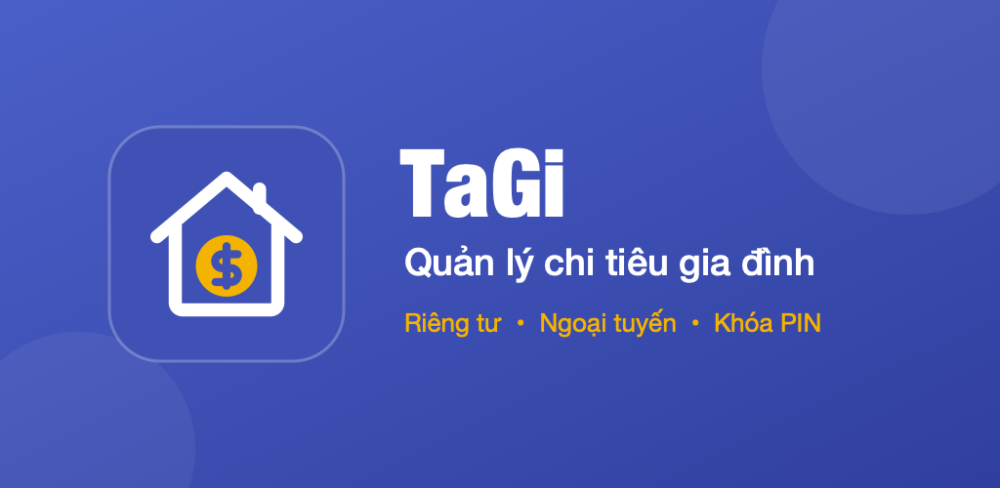

# TaGi – Store Listing

Google Play limits: app name ≤ 30, short description ≤ 80, full description ≤ 4000 characters.

## App icon


| File | Size | Use |
| --- | --- | --- |
| [assets/store/icon-512.png](assets/store/icon-512.png) | 512 × 512 PNG | Google Play → Store listing → App icon |
| [assets/store/icon-512.jpg](assets/store/icon-512.jpg) | 512 × 512 JPEG | Websites, social posts, docs |

Rendered from [assets/icon.svg](assets/icon.svg) with the macOS built-in `sips` (no extra tools needed):

```sh
sips -s format png  -z 512 512 assets/icon.svg --out assets/store/icon-512.png
sips -s format jpeg -s formatOptions 95 assets/store/icon-512.png --out assets/store/icon-512.jpg
```

Use another size by changing `-z 512 512` (e.g. `-z 1024 1024`).

## Feature graphic

1024 × 500, required by Google Play (PNG or JPEG, up to 15 MB). Upload the JPEG: it is ~60 KB, the PNG is ~450 KB.



| Listing | PNG | JPEG | Source |
| --- | --- | --- | --- |
| vi-VN | [feature-graphic-vi.png](assets/store/feature-graphic-vi.png) | [feature-graphic-vi.jpg](assets/store/feature-graphic-vi.jpg) | [feature-graphic-vi.svg](assets/store/feature-graphic-vi.svg) |
| en-US | [feature-graphic-en.png](assets/store/feature-graphic-en.png) | [feature-graphic-en.jpg](assets/store/feature-graphic-en.jpg) | [feature-graphic-en.svg](assets/store/feature-graphic-en.svg) |

Edit the SVG text, then re-render:

```sh
cd assets/store
for l in vi en; do
  sips -s format png feature-graphic-$l.svg --out feature-graphic-$l.png
  sips -s format jpeg -s formatOptions 95 feature-graphic-$l.png --out feature-graphic-$l.jpg
done
```

---

## Tiếng Việt (vi-VN)

### Tên ứng dụng

```text
TaGi - Quản lý chi tiêu
```

### Mô tả ngắn

```text
Quản lý thu chi, ví, đầu tư và gia đình. Dữ liệu lưu trên máy, khóa bằng PIN.
```

### Mô tả đầy đủ

```text
TaGi giúp bạn và gia đình quản lý tiền bạc đơn giản, rõ ràng và riêng tư. Không cần tài khoản, không đồng bộ đám mây: mọi dữ liệu nằm trên điện thoại của bạn và được bảo vệ bằng mã PIN.

💰 THU CHI & VÍ TIỀN
• Ghi thu nhập, chi tiêu và chuyển tiền giữa các ví
• Nhiều loại ví: tiền mặt, ngân hàng, ví điện tử, thẻ tín dụng, khoản vay, đầu tư
• Danh mục chi tiêu có sẵn và tự tạo thêm không giới hạn, kèm ngân sách
• Đính kèm ảnh hóa đơn cho từng giao dịch
• Lọc giao dịch, xem tổng theo ngày

📊 TỔNG QUAN & BÁO CÁO
• Tổng quan theo tháng: số dư, thu nhập, chi tiêu, chi trung bình mỗi ngày
• Vuốt trái / phải để đổi tháng
• Chạm vào bất kỳ con số nào để xem các giao dịch tạo nên nó
• Báo cáo chi tiêu theo danh mục, thu – chi theo thời gian
• Theo dõi dư nợ và ngày đến hạn thẻ tín dụng

📈 ĐẦU TƯ
• Theo dõi cổ phiếu và tiền mã hóa
• Giá vốn bình quân tự động tính khi mua / bán
• Lãi / lỗ đã chốt và chưa chốt
• Báo cáo hiệu quả đầu tư

👨‍👩‍👧 GIA ĐÌNH
• Quản lý gia đình và hồ sơ từng thành viên
• Lưu ảnh CCCD, xuất ra PDF khi cần
• Chia sẻ thành viên dưới dạng danh bạ (vCard)

🧾 SAO KÊ & HÓA ĐƠN
• Nhập ảnh sao kê ngân hàng bằng nhận dạng chữ (OCR) ngay trên máy – hiện hỗ trợ Techcombank
• Tự nhận số tiền từ ảnh hóa đơn và ảnh chụp màn hình chuyển khoản
• Hóa đơn hàng tháng và nhắc nhở định kỳ

💱 NHIỀU LOẠI TIỀN
• Hỗ trợ VND, USD và vàng (chỉ); số dư từng loại được giữ riêng, không tự quy đổi
• Xem ước tính tổng tài sản quy ra VND theo tỷ giá trực tuyến

🔒 RIÊNG TƯ LÀ TRÊN HẾT
• Dữ liệu chỉ lưu trên thiết bị, hoạt động hoàn toàn ngoại tuyến
• Khóa ứng dụng bằng mã PIN
• Không cần đăng ký tài khoản, không quảng cáo
• Sao lưu ra tệp .bk, chia sẻ và khôi phục trên máy khác dễ dàng

🌐 Giao diện tiếng Việt và tiếng Anh.

TaGi – quản lý tài chính gia đình, gọn trong lòng bàn tay.
```

---

## English (en-US)

### App name

```text
TaGi - Family Money Manager
```

### Short description

```text
Track spending, wallets, investments and family. Data stays on device, PIN lock
```

### Full description

```text
TaGi helps you and your family manage money in a simple, clear and private way. No account, no cloud sync: all your data stays on your phone and is protected by a PIN.

💰 INCOME, EXPENSES & WALLETS
• Record income, expenses and transfers between wallets
• Wallet types: cash, bank, e-wallet, credit card, loan, investment
• Ready-made expense categories, plus unlimited custom ones with budgets
• Attach receipt photos to any transaction
• Filter transactions and see daily totals

📊 OVERVIEW & REPORTS
• Monthly overview: balance, income, expenses, average daily spending
• Swipe left / right to change month
• Tap any number to see the transactions behind it
• Reports by category and income vs. expenses over time
• Credit card summary: amount owed and statement due date

📈 INVESTMENTS
• Track stocks and crypto
• Weighted average cost calculated automatically on buy / sell
• Realized and unrealized profit & loss
• Investment performance report

👨‍👩‍👧 FAMILY
• Manage families and member profiles
• Store ID card photos and export them as a PDF
• Share a member as a contact card (vCard)

🧾 STATEMENTS & BILLS
• Import bank statement photos with on-device text recognition (OCR) – Techcombank supported
• Detects amounts in receipts and bank-transfer screenshots
• Monthly bills and recurring reminders

💱 MULTI-CURRENCY
• VND, USD and gold (chỉ); each currency keeps its own balance and is never auto-converted
• Approximate total in VND using online exchange rates

🔒 PRIVACY FIRST
• Data stays on your device and works fully offline
• PIN lock
• No sign-up, no ads
• Back up to a .bk file and restore it on another device

🌐 Available in English and Vietnamese.

TaGi – family finances, right in your pocket.
```
